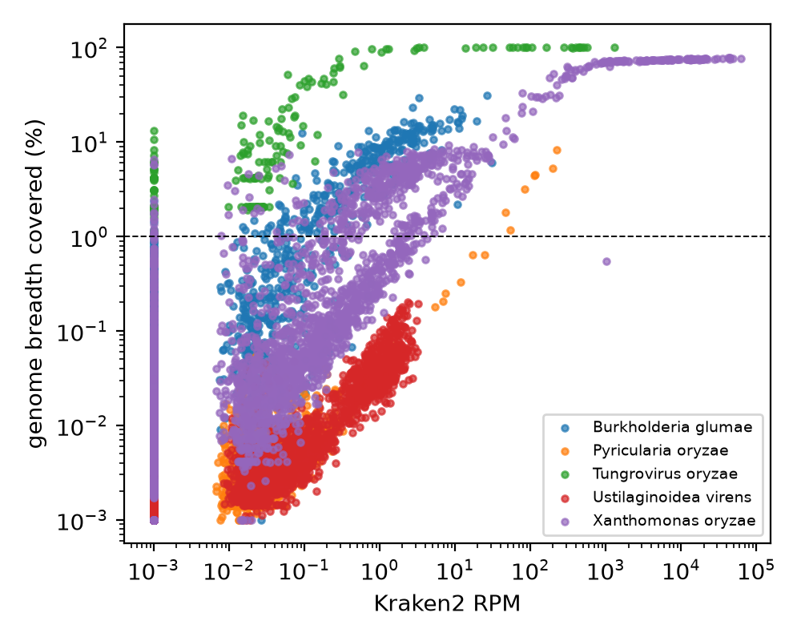
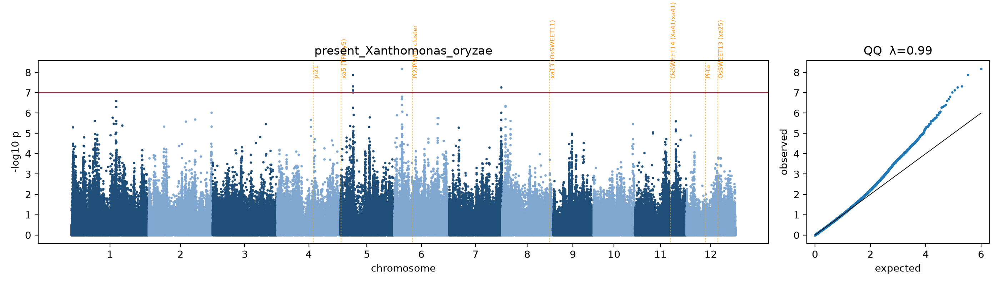

# Discarded reads as a disease screen

**Re-mining the 3,000 Rice Genomes for the pathogen DNA nobody looked at.**

[](https://github.com/The-Graduate-Life/rice3k_unmapped/actions/workflows/lint.yml)
[](LICENSE)
[](https://registry.opendata.aws/3kricegenome/)

> **Want to reproduce it?** Go straight to **[FOLLOWME.md](FOLLOWME.md)**: three commands, step by step.

---

## 1. The idea in one paragraph

The [3,000 Rice Genomes Project](https://doi.org/10.1038/s41586-018-0063-9) sequenced leaf DNA from
3,024 rice varieties to study rice genes. About 98% of each sample's DNA matched the rice reference
genome and was used; the remaining ~2% (0.3–5 million reads per variety) did not match and was set
aside. But a leaf is never just rice: it carries bacteria, fungi and viruses, and their DNA is in
that discarded fraction. This project pulls **only those discarded reads** back out of the public
data, identifies the microbes in them with two independent methods, and asks two questions:

1. **Which rice varieties were carrying which pathogens when they were sampled?** (a disease survey nobody planned)
2. **Is carrying a pathogen associated with particular rice DNA variants?** (a genome-wide association study, GWAS)

It is a *data reuse* project: no new samples, no new sequencing, only public data and one night on a
supercomputer.

## 2. Key results

| | |
|---|---|
| Rice varieties analysed | **2,962** of 3,024 (55 deposited files contain no unmapped reads; 7 could not be downloaded) |
| Data actually transferred | **575 GB** instead of 27 TB (only the unmapped block of each file, via its index) |
| Bacterial leaf blight (*Xanthomonas oryzae*) | **218 varieties (7.4%)** with genome-validated infection |
| Rice blast (*Pyricularia oryzae*) | 7 varieties |
| Tungro virus | 3 real infections; 30 more signals were virus fragments **built into the rice genome** |
| Bacterial panicle blight (*Burkholderia glumae*) | 2 real infections; 170 signals were harmless relatives |
| GWAS, blight presence | **3 loci** (chr 5, 6, 7) above the genome-wide threshold, calibrated test (λ = 0.99) |
| Robustness | all 3 loci keep **2.6–3.6× higher odds** of infection when comparing plants of the same sample batch *and* subpopulation |

Three findings matter most for anyone reusing data like this:

* **Validation changes everything.** Each check removed a different impostor: relatives sharing a few
  genes (genome *breadth* test), relatives similar along the whole genome but at lower identity (per-read *identity*
  test; e.g. B001's *Xanthomonas*-like reads average 93.7%, only 15% reach ≥ 97%), and ancient viral DNA inside the rice genome (also caught by identity).
  Stopping one check early would have overstated panicle blight 35-fold.
* **Infection clusters by sample batch.** 25% of one ID series carries blight versus <1% of another, so
  the plants were most likely grown in seasons or fields with and without an outbreak. The GWAS is
  run with and without batch covariates.
* **Unvalidated "microbial load" maps rice structural variants, not disease genes.** False smut had
  zero confirmed cases yet still produced GWAS peaks: rice DNA missing from the reference genome is
  misread as microbial. Only validated infections should be mapped.

| Two methods agree | GWAS of blight presence |
|---|---|
|  |  |

Full numbers, tables and caveats: **[docs/RESULTS.md](docs/RESULTS.md)**.

## 3. How it works

```
3K BAM files on AWS (public)
   │  samtools index lookup: fetch ONLY the unplaced-unmapped block (~7 s, ~190 MB per variety)
   ▼
unmapped read pairs ──minimap2──▶ remove rice mitochondrion / chloroplast / PhiX   (mito reads kept)
   │
   ├─▶ Kraken2 + Bracken (PlusPF-16GB)        "quick ID": which taxa, how many reads
   │
   └─▶ minimap2 vs 5 pathogen genomes        "check it": genome breadth, spread, per-read identity
             │
             ▼
   call per variety × pathogen:  confirmed / congener (relative) / unvalidated / absent
             │
             ▼
   GEMMA linear mixed model on 496k SNPs (kinship + PC1–5 + depth, ± sample-batch covariates)
             │
             ▼
   locus robustness check: Mantel–Haenszel odds ratios within batch × subpopulation strata
```

A pathogen counts as **confirmed** in a variety only if *all* of these hold:

| Rule | Why |
|---|---|
| ≥ 20 Kraken2 reads | the quick ID sees it |
| ≥ 50 reads align to the pathogen genome (MAPQ ≥ 20) and cover ≥ 1% of it | the slow check sees it too |
| observed / expected breadth ≥ 0.6 | reads are spread like a real genome, not piled on a few shared genes |
| ≥ 50% of aligned reads at ≥ 97% identity | it is the pathogen itself, not a cousin at ~90% identity |

Every rule was added because the data showed a specific failure; the reasoning is in
**[docs/METHODS.md](docs/METHODS.md)**.

## 4. Reproducing it

```bash
git clone git@github.com:The-Graduate-Life/rice3k_unmapped.git && cd rice3k_unmapped   # SSH (see FOLLOWME §1)
bash install.sh                 # conda environment with every tool (Miniforge is installed if needed)
bash tests/smoke_test.sh        # optional: 3 varieties on any laptop, ~10 min
bash run_pipeline.sh            # the whole analysis, submitted as chained cluster jobs
```

`run_pipeline.sh` detects **PBS** (used here, Alabama Supercomputer), **SLURM**, or runs **locally**,
submits all stages at once with job dependencies, and skips anything already done, so it can be
re-run or resumed safely (`--from`, `--status`). The detailed walk-through, expected numbers at each
step and a troubleshooting table are in **[FOLLOWME.md](FOLLOWME.md)**.

| Resource | Full run |
|---|---|
| Wall time | processing ~1–2 h with ~60 jobs running at once on ASC; identity ~1 h; GWAS ~1–6 h; plus queue waits. Plan for one night. |
| Compute | a few hundred core-hours (estimate) |
| Scratch disk | ~45 GB peak (Kraken2 DB 19 GB, SNPs 0.8 GB, mitochondrial BAMs, in-flight reads) |
| Memory | 24 GB per processing job (Kraken2 DB), 16 GB for GWAS |
| Internet | compute nodes must reach `s3.amazonaws.com` (or see FOLLOWME §9) |

## 5. Repository layout

```
README.md                  this file: what the project is and what it found
FOLLOWME.md                step-by-step reproduction guide + troubleshooting
install.sh                 one-command software setup (conda env "reuse3k")
run_pipeline.sh            one-command analysis (PBS / SLURM / local), --status, --from, --dry-run
config.sh                  paths, parameters, cluster queue/resource profiles   <- the only file to edit
env/reuse3k.yml            conda environment definition

jobs/                      scheduler-independent job bodies, one per stage
scripts/
  00_setup_refs.sh         downloads: decoys, pathogen genomes, Kraken2 DB, SNP set, read totals
  01_process_accession.sh  per variety: stream unmapped reads -> decoys -> Kraken2/Bracken -> alignment -> QC
  02_identity_check.sh     per-read identity vs pathogen genomes (separates pathogens from relatives)
  03_aggregate.py          tables, presence calls, prevalence, GWAS phenotype/covariate files
  04_plots.py              figures; with --gwas: Manhattan/QQ, hit lists, gwas_summary.tsv
  05_locus_check.py        GWAS loci: genotype vs infection within batch x subpopulation (MH odds ratio)
  06_collect_results.sh    copies small results + software versions into results/
  utils/fetch_on_login_node.sh   fallback for clusters whose compute nodes have no internet
metadata/
  accessions_all.txt       3,024 accession IDs
  accessions_pilot100.txt  99-accession pilot, stratified by subpopulation
  accession_metadata.tsv   name, country, SRA sample, K=9 subpopulation (Q >= 0.6, else admix), q_max
  target_taxa.tsv          7 rice pathogens: Kraken2 taxid, disease, validation genome
  known_R_genes.tsv        known resistance/susceptibility genes drawn on the Manhattan plots
results/                   figures + summary tables of the published run (filled by 06_collect_results.sh)
docs/
  METHODS.md               detailed methods, parameters and the reasoning behind each rule
  RESULTS.md               all results, tables and caveats
tests/smoke_test.sh        end-to-end test on 3 varieties
```

## 6. Limitations

* **Infected ≠ susceptible.** Presence of pathogen DNA reflects exposure *and* susceptibility; the
  sample batch effect shows exposure matters a lot.
* **One snapshot:** one leaf, one season, wherever the seed was grown out for DNA extraction.
* **DNA only:** RNA viruses (most plant viruses) are invisible.
* **The three loci are candidates.** The robustness check uses the same data; independent replication
  (e.g. an inoculation trial) is needed.
* Kraken2 databases are biased toward well-sequenced microbes; two of the seven target taxa have no
  validation genome and are reported as *unvalidated* only.

## 7. Data sources and credits

* 3,000 Rice Genomes BAMs, SNP set (LD-pruned v2.1), PCA: `s3://3kricegenome` (AWS Open Data);
  Wang et al. 2018 *Nature* 557:43; Li et al. 2014 *GigaScience* 3:8. Subpopulations: SNP-Seek K=9 Q-matrix.
* Kraken2 PlusPF-16GB index: Langmead lab, genome-idx.s3.amazonaws.com.
* Reference genomes (NCBI): *X. oryzae* PXO99A CP000967.2 · RTBV NC_001914.1 · *P. oryzae* GCF_000002495.2 ·
  *B. glumae* GCF_000022645.2 · *U. virens* GCF_000687475.1 · rice chloroplast NC_001320.1 ·
  rice mitochondrion BA000029.3 · PhiX NC_001422.1.
* Tools: samtools, minimap2, Kraken2, Bracken, seqkit, GEMMA, PLINK 1.9, pandas/scipy/matplotlib.
* Computing: Alabama Supercomputer Authority.
* Inspired by the Research Parasite Award commentaries (Duvallet 2020; Skinnider 2024, *GigaScience*).

Cite this work with [CITATION.cff](CITATION.cff). Code: MIT ([LICENSE](LICENSE)); downloaded data keep
their providers' terms.
