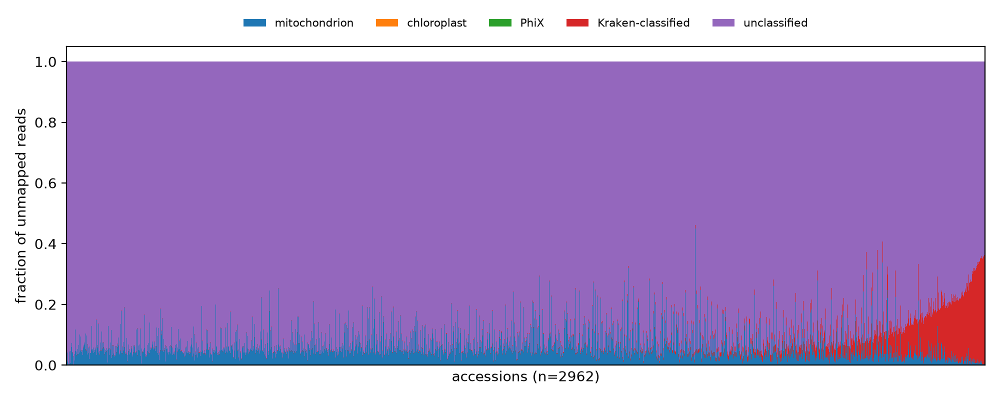
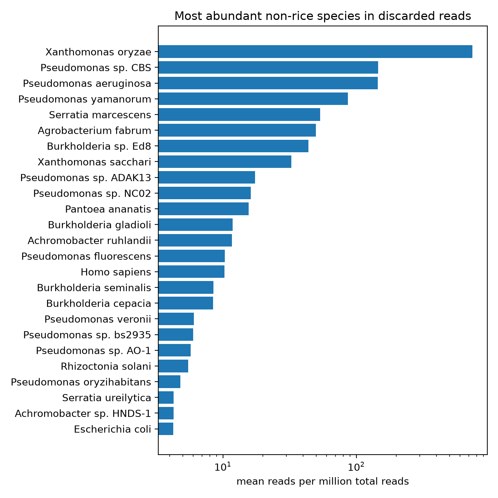
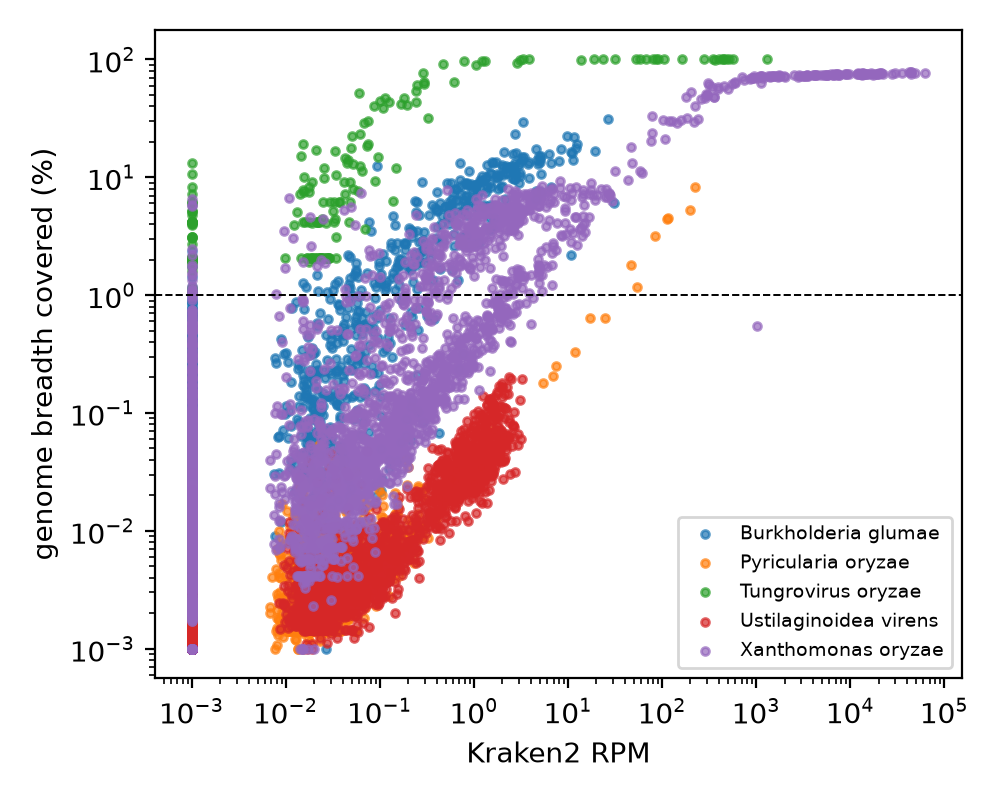
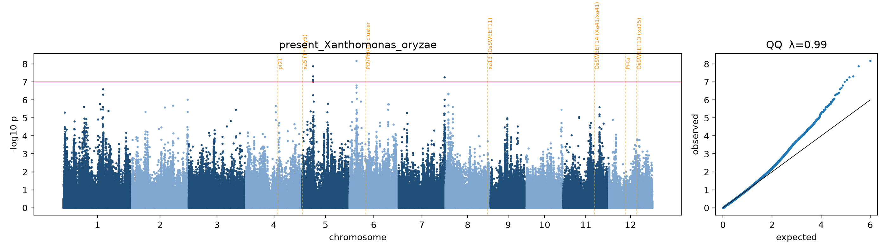

# Results

Run of 2026-11-08/09 on the Alabama Supercomputer (PBS), Kraken2 PlusPF-16GB, all 3,024 accessions.
Figures are in `results/figures/`; tables are written to `results/tables/` and `results/gwas/` by
`scripts/06_collect_results.sh`.

## 1. Accounting

| | Accessions |
|---|---|
| In the 3K panel | 3,024 |
| **Analysed** | **2,962** |
| Deposited BAM has no unmapped block (`logs/no_unmapped.txt`) | 55 (Thailand 12/150, China 17/473 over-represented; by subpop: ind3 14, ind1A 12, ind2 8, admix 7, temp 5, trop1 3, aro 2, trop2 2, ind1B 1, aus 1) |
| Unmapped block not retrievable from S3 (4 attempts) | 7 (IRIS_313-11643, -11657, -11669, -11671, -11723, -11801, -11812) |

Excluded accessions are `NA` in every table and GWAS, never zero.

## 2. What the discarded reads contain

* 0.3–5.4 M unmapped reads per accession (~2% of all reads).
* Rice mitochondrion ~5% (2–30%); chloroplast ≈ 0 (chloroplast-like reads map to nuclear insertions); PhiX 0.
* Most of the rest is **unclassified**: probably rice DNA absent from the single reference genome plus
  unsequenced microbes. Kraken2-classified share: near 0 for most accessions, up to ~35% for the most colonised.
* GC of non-organelle reads peaks at 55–70%, bacterial rather than rice-like (~43%).

*X. oryzae* is the most abundant microbe by mean RPM, driven by a few heavy infections. In
IRIS_313-9283 (Pakistan, *aus*), **1.4% of all reads** (14,415 RPM) are *X. oryzae*, covering 75% of
its genome. The other abundant taxa are common plant-associated bacteria (*Pseudomonas*, *Pantoea*,
*Serratia*, *Agrobacterium*, *Burkholderia*).

## 3. Validated pathogen calls

| Pathogen | Kraken + alignment signal | + breadth ratio ≥ 0.6 | + identity (≥ 50% reads ≥ 97%) | Interpretation |
|---|---|---|---|---|
| *X. oryzae* (bacterial leaf blight) | 514 | 275 | **218 (7.4%)** | real pathogen; 296 related *Xanthomonas* |
| *B. glumae* (panicle blight) | 172 | 70 | **2** | almost all are related *Burkholderia* |
| Tungro virus (RTBV) | 33 | 33 | **3** | 30 full-length but low-identity signals: most likely RTBV-like sequences integrated in the rice genome |
| *P. oryzae* (blast) | 7 | 7 | **7** | all 7 in the IRIS 8k batch, all but one *temperate japonica* |
| *U. virens* (false smut) | – | 0 | **0** | Kraken2 reads in many accessions, but ≤ 0.2% breadth: shared snippets |
| *R. solani* / *F. fujikuroi* | 82 / 11 | – | – | no validation genome: *unvalidated* |

Real infections climb to a breadth plateau as Kraken2 RPM rises (*X. oryzae* ~75% of the genome;
tungro 100%); false smut stays below the 1% line at any RPM.

## 4. Infection clusters by sample batch

| ID series | n | *X. oryzae* confirmed |
|---|---|---|
| IRIS 7k | 74 | 0% |
| IRIS 8k | 356 | 16.3% |
| **IRIS 9k** | 294 | **24.5%** |
| IRIS 10k | 606 | 11.4% |
| IRIS 11k | 849 | 0.5% |
| IRIS 12k | 210 | 1.0% |
| IRIS 15k | 15 | 0% |
| CX (CAAS set) | 312 | 3.8% |
| B (3K pilot set) | 246 | 0.4% |

Prevalence by subpopulation is much flatter (2.3% *ind1A* to 11.5% *aro*). The most likely explanation:
the IRIS 8k–10k series were grown out during a blight outbreak. Blast shows the same clustering.

## 5. GWAS

GEMMA LMM, 495,922 SNPs, 12 traits × 2 covariate sets (base = PC1–5 + depth; batch = + batch
dummies). Bonferroni −log10 p = 7.0; stricter across 12 traits ≈ 8.1.

| Trait | λ base / batch | top locus | −log10 p base / batch | Reading |
|---|---|---|---|---|
| **present *X. oryzae*** (218 cases) | 0.99 / 1.00 | **chr6: 4,641,440** (same SNP in both) | **8.17 / 7.51** | the one trait built on validated infections |
| rpm *X. oryzae* | 1.01 / 1.00 | – | 6.57 / 6.23 | no hit |
| rpm *P. oryzae* | 0.95 / 0.96 | chr8: 14.4–15.8 Mb | 10.75 / 8.95 | only 7 real cases: caution |
| rpm *R. solani* | 0.99 / 0.99 | chr6 | 8.21 / 11.63 | unvalidated taxon: caution |
| rpm tungro | 1.00 / 0.98 | chr7 / chr5 | 7.96 / 9.45 | expected for integrated RTBV-like sequences |
| rpm *U. virens* | 1.02 / 1.01 | chr11 / chr4 | 9.89 / 7.87 | **negative control: zero real cases, yet hits** |
| load Bacteria / Fungi / Viruses / human | 0.98–1.05 | various | ≤ 9.1 | fungal and viral load hits vanish with batch |

* λ = 0.95–1.05 in all 24 scans: kinship + PCs (+ batch) control structure well.
* None of the top loci is near a known resistance/susceptibility gene (xa5, xa13/OsSWEET11,
  OsSWEET13, OsSWEET14, Pi-ta, Pi2/9, pi21).
* **GWAS of unvalidated microbial "load" maps rice structural variants.** Rice DNA missing from
  Nipponbare lands among the unmapped reads, a fraction is k-mer-assigned to a microbe, and the scan
  finds where that rice DNA sits. Hence false smut "hits" with no infections. Only validated calls
  should be mapped.

## 6. Blight-presence loci and their robustness

Base scan, 6 SNPs above Bonferroni, grouped into 3 loci:

| Locus | SNPs | best −log10 p | infected, 2 vs 0 copies | risk-allele carriers |
|---|---|---|---|---|
| chr5: 7.051–7.070 Mb | 4 in 19 kb | 7.88 (7,055,832) | 22% vs 6% | almost only *japonica* |
| chr6: 4,641,440 | 1 | 8.17 | 13% vs 5% | *japonica* vs *indica* split |
| chr7: 29,223,762 | 1 | 7.27 | 17% vs 6% | mixed: *aro*, trop2, temp, ind2 |

Mantel–Haenszel odds ratio (homozygotes, `05_locus_check.py`):

| Locus | within batch | within subpop | **within batch × subpop** | telling stratum |
|---|---|---|---|---|
| chr5 | 2.89 (p 3e-7) | 4.23 (p 2e-9) | **3.00 (p 2e-5, 14 strata)** | trop1: 11/23 vs 25/348 infected |
| chr6 | 2.11 (p 3e-7) | 3.82 (p 8e-8) | **3.62 (p 3e-6, 21 strata)** | *japonica* without the allele: 0/202 infected, with it: 78/567 |
| chr7 | 2.70 (p 1e-7) | 3.41 (p 7e-10) | **2.62 (p 2e-5, 23 strata)** | trop1: 12/27 vs 23/340 |

All three loci keep ~3× higher odds after holding batch and subpopulation fixed, so "the risk allele
just marks *japonica* grown in the outbreak batch" is not a sufficient explanation.

> Re-running `05_locus_check.py` from this repository groups the non-IRIS accessions as `B` and `CX`
> (the original interactive check split them by their first two characters), so stratum counts and
> odds ratios may differ slightly in the second decimal.

Caveats: same data (not a replication; winner's curse inflates the ORs); presence mixes resistance
and exposure (e.g. flowering stage at sampling); the trop1 carriers at chr5 and chr7 may be one
sub-lineage.

## 7. Open items

* Genes under the three loci (RAP-DB: chr05 6.85–7.25 Mb, chr06 4.40–4.90 Mb, chr07 29.0–29.45 Mb).
* Whether the chr5 and chr7 trop1 carriers are the same accessions (genotype correlation).
* Identity values and subpopulations of the 30 low-identity tungro signals (integrated sequences are
  expected mainly in *japonica*; Kunii et al. 2004).
* Where the 3K plants were grown for DNA extraction (Li et al. 2014, *GigaScience*), to confirm the
  batch interpretation.
* Mitochondrial reads (`$WORK/results/mito/`) for cytoplasm/CMS typing.
